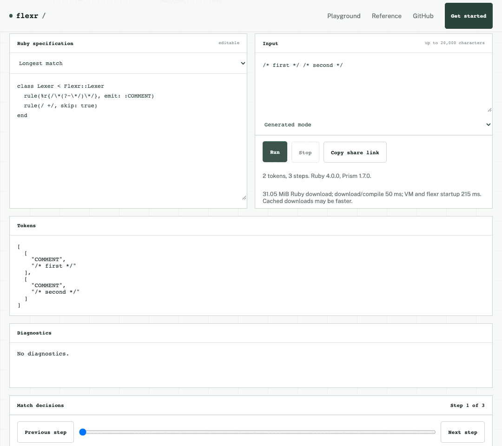

<h1 align="center">
  
</h1>

<p align="center">
  <strong>A lexer generator for Ruby</strong><br>
  Write lexer rules once and run them directly or generate a Ruby scanner.
</p>

<p align="center">
  <a href="https://rubygems.org/gems/flexr"></a>
  <a href="https://rubygems.org/gems/flexr"></a>
  <a href="#quick-start"></a>
  <a href="https://github.com/ydah/flexr/actions/workflows/runtime.yml"></a>
  <a href="LICENSE.txt"></a>
</p>

<p align="center">
  <a href="#quick-start">Quick start</a> ·
  <a href="https://ydah.github.io/flexr/playground/">Playground</a> ·
  <a href="docs/README.md">Documentation</a> ·
  <a href="https://ydah.github.io/flexr/">Product site</a>
</p>

---

## Quick start

Install flexr on Ruby 3.4 or newer.

```sh
gem install flexr
```

Save the rules as `lexer.flexr.rb`.

```ruby
require "flexr"

class Lexer < Flexr::Lexer
  emits :INTEGER, :PLUS

  rule(/[ \t\r\n]+/, skip: true)
  rule(/[0-9]+/) { emit :INTEGER, text.to_i }
  rule(/\+/) { emit :PLUS }
end
```

Run the lexer on a short input.

```sh
ruby -r ./lexer.flexr.rb -e 'p Lexer.new("12 + 3").tokens'
```

```ruby
[[:INTEGER, 12], [:PLUS, "+"], [:INTEGER, 3]]
```

## Generate a scanner

Generate a Ruby file from the same rules.

```sh
flexr lexer.flexr.rb -o lexer.rb
```

Load `lexer.rb` in your application with the flexr gem installed. Use
[`--standalone`](docs/how-to/deploy-a-standalone-lexer.md) to embed the runtime
when you need to distribute a single file that runs without the gem.

Generation reads the specification statically by default. The `--eval` option
executes the Ruby source at build time. Use it only with trusted specifications.

## Matching rules

By default, flexr chooses the longest match at each input position. For
example, `==` wins over `=` even if the `=` rule comes first. For matches of
equal length, higher `priority:` values win. Definition order breaks ties
between rules with the same priority.

Rules support a [subset of Ruby regexp syntax](docs/reference/regexp.md)
designed for DFA matching.

## Playground

Run a lexer in the [browser playground](https://ydah.github.io/flexr/playground/)
to inspect its tokens, diagnostics, and match decisions.



[Open the specifications from the demo](docs/how-to/try-playground-demos.md).

## Documentation

- [Calculator tutorial](docs/tutorial/build-a-calculator-lexer.md) walks through building, checking, and generating a lexer.
- [Documentation map](docs/README.md) links to how-to guides, including parser integration and migration.
- [Reference](docs/reference/README.md) covers the DSL, CLI, diagnostics, and API stability.
- [Examples](examples/) contains runnable lexers and parser integrations.
- [Changelog](CHANGELOG.md) lists release highlights and upgrade notes.

## Contributing

See [CONTRIBUTING.md](CONTRIBUTING.md) for local checks and
[RELEASING.md](docs/RELEASING.md) for the release process.

## License

MIT. See [LICENSE.txt](LICENSE.txt).
