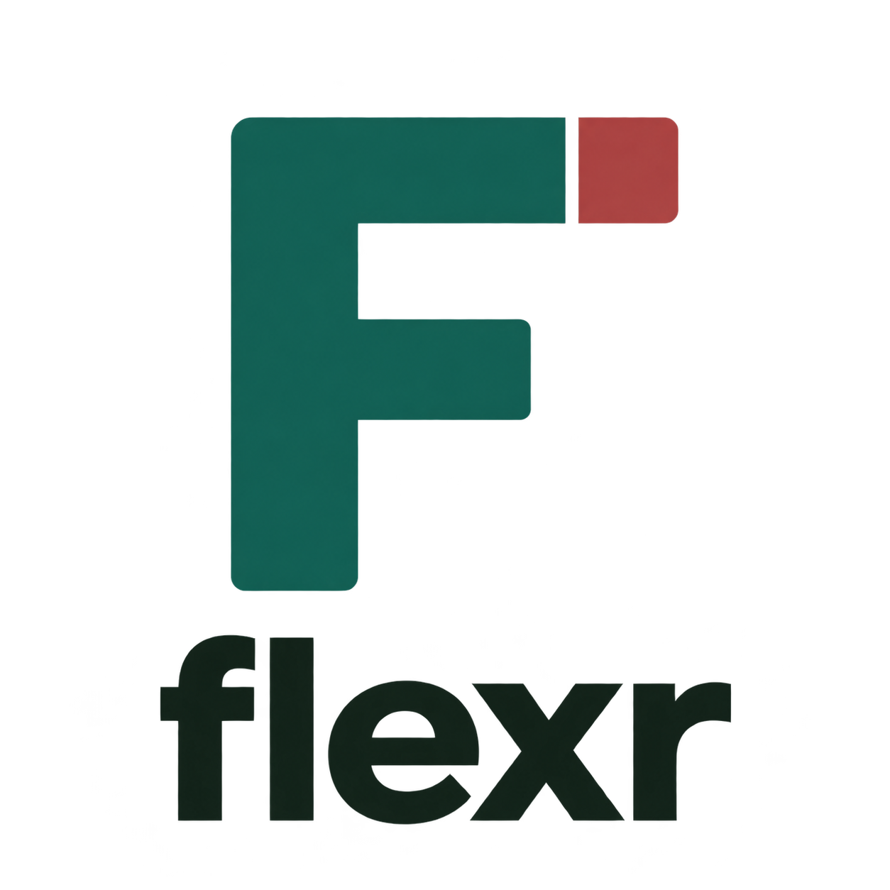

<h1 align="center">
  
</h1>

<p align="center">
  <strong>A lexer generator for Ruby</strong>
</p>

<p align="center">
  <a href="https://rubygems.org/gems/flexr"></a>
  <a href="https://rubygems.org/gems/flexr"></a>
  <a href="#compatibility-and-stability"></a>
  <a href="https://github.com/ydah/flexr/actions/workflows/runtime.yml"></a>
  <a href="LICENSE.txt"></a>
</p>

<p align="center">
  <a href="https://ydah.github.io/flexr/">Product site</a> ·
  <a href="https://ydah.github.io/flexr/playground/">Playground</a> ·
  <a href="docs/README.md">Documentation</a>
</p>

---

Write one specification, run it directly while developing, or generate Ruby
for deployment when startup cost and build reproducibility matter. Both modes
use the same rules and actions.


[Open the specifications from the demo](docs/how-to/try-playground-demos.md).

## Why flexr?

- Ordinary Ruby DSL; no separate lexer language is required.
- Leftmost-longest matching: the longest rule wins, and source order breaks
  equal-length ties.
- Runtime/generated parity with diagnostics for unsupported or risky designs.

## Quick start

```sh
gem install flexr
```

```ruby
# lexer.flexr.rb
require "flexr"

class Lexer < Flexr::Lexer
  emits :INTEGER, :PLUS

  rule(/[ \t\r\n]+/, skip: true)
  rule(/[0-9]+/) { emit :INTEGER, text.to_i }
  rule(/\+/) { emit :PLUS }
end

Lexer.new("12 + 3").tokens
# => [[:INTEGER, 12], [:PLUS, "+"], [:INTEGER, 3]]
```

Follow the [calculator tutorial](docs/tutorial/build-a-calculator-lexer.md)
for validation, generation, and runtime/generated comparison.

## How matching works

At each input position flexr considers every active rule and chooses the
longest match. If multiple rules consume the same number of bytes, the rule
defined first wins. A rule can use `followed_by:` to inspect trailing context
without consuming it.

The regexp engine is a DFA-oriented subset of Ruby regexp syntax. See the
[regexp reference](docs/reference/regexp.md) before relying on look-around,
backreferences, or other non-regular constructs.

## Runtime or generated?

| Mode | Build requirement | Runtime requirement | Best for |
|---|---|---|---|
| Runtime | `flexr` gem | `flexr` gem | Development, tests, and dynamic Ruby specs |
| Generated | `flexr` plus Prism on Ruby 3.4+ | `flexr` gem and Ruby 3.4+ | Reproducible deployment artifacts |
| Standalone generated | `flexr` plus Prism on Ruby 3.4+ | Generated file and Ruby 3.4+ standard library | Distribution without the gem |

Static generation is the default. Use `--eval` only for trusted specifications;
it executes the specification during the build. See the
[generation guide](docs/how-to/generate-a-lexer.md) and
[standalone deployment guide](docs/how-to/deploy-a-standalone-lexer.md).

## Is flexr right for you?

flexr fits projects that want a Ruby-native lexer, deterministic longest-match
semantics, Unicode-aware byte-level matching, and parser integration. It is not
a drop-in replacement for a first-match lexer, and it does not accept regexp
features that require backtracking or capture-dependent matching.

## Documentation

Start with the [documentation map](docs/README.md), then choose the path that
matches your task:

- [Tutorial](docs/tutorial/build-a-calculator-lexer.md) — build one lexer from
  source to generated artifact.
- [How-to guides](docs/how-to/) — solve one focused integration or runtime
  problem.
- [Reference](docs/reference/README.md) — look up APIs, CLI options, regexp
  support, diagnostics, and compatibility.
- [Explanation](docs/explanation/) — understand matching, backends, Unicode,
  generation, and security decisions.
- [Examples](examples/) — executable specifications and parser integrations.
- [Changelog](CHANGELOG.md) — release highlights and upgrade notes.

## Compatibility and stability

Runtime Ruby support starts at 3.4. The generator requires Ruby 3.4 or newer
because it uses Prism. Stable and experimental APIs are listed in the
[public API contract](docs/reference/public-api.md). The vendored Unicode
snapshot and generated-artifact policy are described in the
[compatibility reference](docs/reference/compatibility.md).

## Security

Lexer actions are Ruby code and remain Ruby code in generated output. Static
generation parses the specification, while `--eval` executes it. Treat source
specifications and generated files as trusted build inputs; never process an
untrusted specification with `--eval`.

## Contributing

Run `bundle exec rake docs:verify` together with the normal test and generated
artifact checks before submitting changes. See
[CONTRIBUTING.md](CONTRIBUTING.md) and [RELEASING.md](docs/RELEASING.md).

## License

MIT. See [LICENSE.txt](LICENSE.txt).
